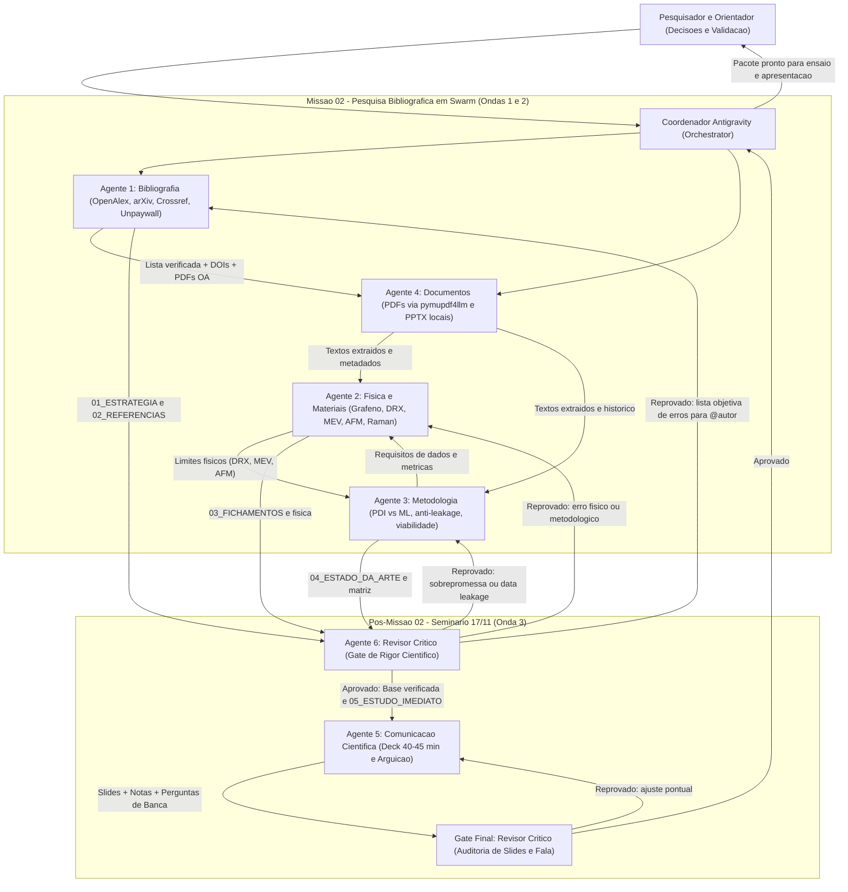

# 04 — Arquitetura de Agentes e Orquestração (Missão 01 → Missão 02 e Seminário)

**Projeto:** Viabilidade de ferramenta computacional para caracterização de grafeno e materiais relacionados (DRX, MEV, AFM, PDI e ML/VC)  
**Instituição / Programa:** PPGCEM — Universidade Federal do Cariri (UFCA) | Disciplina: *Seminários I*  
**Orientador:** Prof. Dr. Job Saraiva Furtado Neto | **Discente:** Emerson de Sousa Gomes  
**Data de referência:** 16/11/2026 (Seminário amanhã: **17/11/2026**)  
**Estado real da pesquisa:** **Fase investigativa** — **software NÃO desenvolvido e NÃO validado**.

> [!IMPORTANT]
> **Alerta oficial de duração (`Seminarios-I-Programa.pdf`, p. 5):** o programa oficial da disciplina estabelece apresentações individuais entre **40 e 45 minutos** (e **não 60 minutos** como mencionado inicialmente). Toda a orquestração de produção da apresentação (pós-Missão 02) deve mirar **40–42 min de fala** e reservar os **~15–18 min finais para arguição**.

---

## 1. Base Empírica do Ambiente Antigravity no Sistema Local

Para que a arquitetura não dependa de suposições irreais, todo o desenho abaixo foi fundamentado estritamente nos recursos verificados em `16/11/2026`:

| Componente | Estado verificado localmente | Impacto direto na orquestração |
| :--- | :--- | :--- |
| **SO e Shell** | Windows 10 (`10.0.19045`), PowerShell `5.1` | Scripts inline Python devem usar *here-string* (`@' ... '@ \| & "C:\Users\emer\.local\bin\python3.11.exe" -`). |
| **Python / `uv`** | `uv 0.13.7` (`C:\Users\emer\.local\bin\uv.exe`) e `python3.11.exe` (`Python 3.11.18`) | Scripts de skills e pacotes efêmeros (`pymupdf4llm`, `python-pptx`) devem ser invocados via `uv run` ou caminho absoluto de `python3.11.exe`. |
| **Armadilha `python` / `python3` no `PATH`** | `where.exe python` e `where.exe python3` resolvem para stubs de **0 bytes** em `C:\Users\emer\AppData\Local\Microsoft\WindowsApps\` que falham ao executar | **Bloqueador crítico para `run_workflow`:** a skill `run-workflow` exige `python3` (>= 3.8) funcional no `PATH`. Enquanto o stub WindowsApps prevalecer, **`run_workflow` não deve ser adotado sem teste/correção prévia**. |
| **Node.js** | `node v26.13.0` + `npm/npx 11.20.0` | Viabiliza execução efêmera via `npx` (ex.: `@marp-team/marp-cli`) sem instalação global. |
| **Binários ausentes no `PATH`** | Ausentes: `git`, `pandoc`, `quarto`, `marp`, `typst`, `pdflatex`/`xelatex`/`lualatex`, `tesseract`, `soffice`/`libreoffice`, `zotero`, `gh`, `docker`, `java`, `pip`, `pipx`, `conda` | Ausência de `git` exige cautela com `workspace:"share"`/`"branch"` no `/swarm` (usar `workspace:"inherit"` com pastas/arquivos estritamente particionados). Ausência de `java`/`docker`/`zotero` inviabiliza GROBID e Zotero MCP hoje. |
| **Plugins e Skills ativos** | `config.json`: `science v1.4.0` (`literature_search_openalex`, `literature_search_arxiv`, `literature_search_europepmc`, `pubmed_database`, `uv`, `workflow_skill_creator`, MCP `biomolecular_structure_viewer_mcp`), `google-antigravity-sdk v0.0.9`, `swarm` (`enabled: true`). Builtin: `native_swarm`, `run-workflow`, `agy-customizations`, `generative_ui`. | `/swarm` e as skills literárias do plugin `science` estão 100% operacionais hoje sem nenhuma instalação global. |
| **Credenciais e MCP externos** | `C:\Users\emer\.env` ausente; `mcp_config.json` global vazio (`0` bytes) | OpenAlex opera sem chave (orçamento compartilhado de `$0,10/dia` por IP; `download-pdf` em `content.openalex.org` requer `OPENALEX_API_KEY`); Semantic Scholar sem chave sofre HTTP `429` rápido. |

---

## 2. Análise Comparativa dos Mecanismos Reais do Antigravity

O Antigravity oferece três mecanismos nativos distintos de delegação e paralelismo. Confundir suas finalidades gera desperdício de cota, colisões de arquivo ou falhas de execução no Windows 10.

### 2.1 `/swarm` (Plugin `swarm` + skill `native_swarm`)
- **Mecanismo real:** Um coordenador (`@coordinator`) cria trabalhadores independentes (`swarm{action:"add", name, brief}`) que se comunicam via *message board* compartilhado (`post_message`, `read_board`, `swarm_wait`), apoiados por `narrator` e `monitor` (quando presentes na lista de skills do coordenador).
- **Quando usar:**
  - Tarefas multidisciplinares em que papéis distintos produzem artefatos complementares em paralelo (ex.: Missão 01 e Missão 02 — busca bibliográfica, auditoria de documentos locais, análise física/metodológica e revisão crítica independente).
  - Fluxos em que é indispensável **propriedade exclusiva de arquivos** e **ciclo iterativo Autor ↔ Revisor Crítico** antes de aceitar a entrega.
  - Situações que precisam rodar **hoje (16/11)** no Windows 10 sem depender de `python3` no `PATH` nem de `git`.
- **Regras operacionais e cuidados:**
  - **Cota (*Preview & Quota Heavy*):** cada `@menção` acorda o agente destinatário e consome um turno completo. Usar `@nome` como campainha apenas no próximo ator da cadeia (nunca em CC para `@coordinator` em repasses intermediários).
  - **Isolamento de escrita sem `git`:** como `git` não está no `PATH`, evitar `workspace:"share"` ou `"branch"` sem verificação; usar `workspace:"inherit"` garantindo no *brief* que **nenhum par de agentes edita o mesmo arquivo ou pasta**.
  - **Relações por `#seq`:** citar mensagens anteriores pelo número de sequência (`#4`) em vez de copiar blocos extensos no *board*.

### 2.2 `run_workflow` (Skill `run-workflow`)
- **Mecanismo real:** Executa um script Python assíncrono com primitivas `phase()`, `log()`, `agent(prompt, schema, type_name, model)`, `parallel()`, `pipeline()`, `call_tool()` e `trajectory()`. Exige que cada `agent()` conclua chamando a ferramenta `finish` com um payload validado por **JSON Schema**. Suporta `model="flash"` ou `"flash_lite"` para *fan-out* de menor custo.
- **Quando usar (somente após pré-requisito resolvido):**
  - Pipelines determinísticos sobre listas dinâmicas cujo fluxo é código puro (ex.: validar metadados de 25 DOIs em paralelo, extrair campos JSON uniformes de 15 PDFs baixados, auditar 30 slides contra um checklist booleano).
- **Alerta crítico no ambiente atual (Windows 10):**
  - Conforme `C:\Users\emer\.gemini\antigravity\builtin\skills\run-workflow\SKILL.md` (linhas 43–44): *"The script runs in its own `python3` process, which needs Python 3.8 or later on `PATH`"*.
  - No ambiente atual, `where.exe python3` aponta para o stub de `0` bytes `C:\Users\emer\AppData\Local\Microsoft\WindowsApps\python3.exe`, que aborta com mensagem da Microsoft Store.
  - **Decisão tática:** **NÃO depender de `run_workflow` para hoje/amanhã (16–17/11)** sem antes validar em teste isolado que `python3` no `PATH` foi corrigido (desabilitando o *App Execution Alias* do Windows 10 ou colocando um executável `python3.exe` real de Python 3.11+ antes de `WindowsApps` no `PATH`).

### 2.3 `invoke_subagent` / `define_subagent` e Custom Agents (`agents/<name>.md`)
- **Mecanismo real:** Chamada pontual a um subagente isolado com tipo nativo (`self`, `research`, `browser`, `review-agent`) ou agente customizado definido em `.agents/agents/<name>.md` (`subagent: true`, `mainAgent: false`, lista explícita de `tools`).
- **Quando usar:**
  - Subtarefas isoladas, descartáveis e de turno único dentro de uma sessão ou dentro de um worker (quando disponível naquele contexto):
    - `research`: consulta web pontual sobre API, norma ou documentação técnica sem poluir a janela de contexto principal.
    - `browser`: renderização e inspeção visual em navegador de slides HTML/Marp ou verificação de página oficial de periódico quando houver acesso web interativo.
    - `self`: leitura/extração focalizada de um PDF longo único ou verificação isolada de consistência.
- **Nota de escopo observada:** nem todo worker do `/swarm` recebe `invoke_subagent` no conjunto de ferramentas exposto (por exemplo, workers padrão operam com `swarm`, `run_workflow` e ferramentas de arquivo/comando/web); o controle de subagentes pontuais cabe principalmente à sessão principal/Orchestrator ou a ambientes configurados com essas ferramentas.

### 2.4 Matriz de Decisão e Regra Anti-Redundância

| Critério | `/swarm` | `run_workflow` | `invoke_subagent` (`research`/`browser`/`self`) |
| :--- | :--- | :--- | :--- |
| **Pronto hoje (16/11) neste Windows 10?** | **Sim (verificado em execução)** | **Não sem corrigir stub `python3` no `PATH`** | Depende da sessão principal (uso pontual) |
| **Comunicação entre agentes** | Bidirecional iterativa via *board* | Unidirecional programática (retorno JSON) | Ponto-a-ponto (pai ↔ subagente único) |
| **Controle de escrita em arquivos** | Propriedade exclusiva explícita por *brief* | `workspace:"share"/"branch"` ou retorno para o pai | Retorno textual para o chamador |
| **Melhor caso de uso acadêmico** | Revisão bibliográfica multi-eixo + defesa de rigor com Revisor Crítico | *Fan-out* estruturado em lote (ex.: fichar N PDFs via JSON Schema) | Tarefa isolada única (ler 1 PDF longo, checar 1 página no browser) |
| **Quando NÃO usar (evitar redundância)** | Micro-tarefa simples de 1 único arquivo/leitura | Discussão científica aberta sem esquema fixo | Substituir debate autor ↔ revisor ou duplicar worker já ativo no `/swarm` |

---

## 3. Mapeamento dos 6 Papéis Solicitados sobre o Antigravity

Os seis papéis previstos no planejamento da pesquisa são mapeados abaixo de forma enxuta, evitando subagentes ociosos ou redundantes:

| Papel Solicitado | Nome sugerido no `/swarm` | Mecanismo Primário (Hoje/Missão 02) | Mecanismo Alternativo / Apoio Pontual | Regra de Parcimônia (Evitar Redundância) |
| :--- | :--- | :--- | :--- | :--- |
| **Agente 1 — Bibliografia** | `@agente-bibliografia` | Worker `/swarm` usando `uv run` (`openalex_cli.py`, `search_arxiv.py`, `europepmc`) e GET read-only Crossref/Unpaywall via `python3.11.exe` | Pós-correção de `python3`: `run_workflow` (`parallel` com `flash`) para checar lote de 20+ DOIs | Não criar subagente por base; um único agente bibliográfico executa todas as APIs em sequência controlada por *rate-limit*. |
| **Agente 2 — Física e Materiais** | `@agente-fisica` | Worker `/swarm` focado em grafeno, grafite, GO/rGO e limites físicos de DRX, MEV, AFM, Raman e TEM | Pode fundir-se com Agente 3 em missões pequenas de < 10 artigos | **Nunca** fundir com Agente 6 (Revisor). Separação obrigatória entre formulação física e auditoria crítica. |
| **Agente 3 — Metodologia** | `@agente-metodologia` | Worker `/swarm` focado em formulação científica, PDI vs. ML/VC, *GroupKFold*/anti-*leakage*, *domain shift* e métricas de validação | Em missões rápidas, pode operar em conjunto com Agente 2 se o volume for pequeno | Responsável direto pela **Matriz de Viabilidade (Grandeza × Técnica × Algoritmo)**, evitando sobrepromessas de software. |
| **Agente 4 — Documentos** | `@agente-documentos` | Worker `/swarm` usando `read_file`, `uv run --with pymupdf4llm` e `python3.11.exe` (`zipfile`/XML para `.pptx`) | `invoke_subagent(type="self")` para isolar leitura de um PDF externo muito longo (> 40 págs.) | Atua na extração fiel dos arquivos locais e PDFs baixados; nunca inventa dados de imagens sem OCR (`tesseract` ausente). |
| **Agente 5 — Comunicação Científica** | `@agente-comunicacao` | Worker `/swarm` (acionado **após** Missão 02/Gate do Revisor) para roteiro de **40–45 min**, slides (`python-pptx` / Marp), notas e treino de arguição | `invoke_subagent(type="browser")` para inspeção visual de renderização HTML/Marp se utilizado | **Inativo durante a Missão 02 pura** (para não gastar cota nem misturar redação de slides antes da base bibliográfica estar verificada). |
| **Agente 6 — Revisor Crítico** | `@revisor-critico` | Worker `/swarm` permanente (auditor independente de contradições, DOIs falsos, erros físicos e promessas inviáveis) | No `run_workflow`, equivalente a `pipeline()` com `finish(schema=AuditReport)` | **Obrigatório e insubstituível.** Nunca edita arquivos dos Agentes 1–5; apenas aprova ou devolve com apontamentos objetivos por `@nome`. |

---

## 4. Fluxo de Orquestração (Diagrama Mermaid)

O diagrama abaixo representa a arquitetura operacional recomendada para a execução da **Missão 02** (pesquisa bibliográfica aprofundada) e da transição controlada para a **Missão 03** (produção da apresentação de 17/11/2026 e treino de arguição), respeitando a regra de propriedade exclusiva de arquivos.

---

## 5. Contratos de Entrada e Saída (I/O) Entre os 6 Agentes

Para impedir que um agente invente premissas do outro ou sobrescreva arquivos compartilhados, cada papel opera sob contrato explícito:

| Agente | Entradas Obrigatórias (Inputs) | Ferramentas Autorizadas | Propriedade Exclusiva de Saída (Outputs) | Critério de Aceite do Contrato | Destinatário (`Handoff`) |
| :--- | :--- | :--- | :--- | :--- | :--- |
| **Agente 1 — Bibliografia** | Strings booleanas dos Eixos A–E; `.licenses/` criadas; dados de referências históricas (`05_plano_bibliografico.md`) | `uv run openalex_cli.py`, `uv run search_arxiv.py`, `uv run` Europe PMC, GET read-only Crossref/DataCite/Unpaywall via `python3.11.exe` | `PESQUISA_BIBLIOGRAFICA/01_ESTRATEGIA/*`, `02_REFERENCIAS/biblioteca_completa.md`, `referencias.bib`, `matriz_comparativa.csv`, `ARTIGOS_PDF/*` | 100% dos DOIs/URLs validados em API; separação clara entre artigo Open Access baixado vs. apenas resumo/metadado; BibTeX sintaticamente válido. | `@agente-documentos` (PDFs) e `@revisor-critico` |
| **Agente 4 — Documentos** | PDFs baixados pelo Agente 1 + documentos locais (`C:\Users\emer\dissertacao\`) | `read_file`, `uv run --with pymupdf4llm`, `python3.11.exe` (`zipfile`/`xml`) | Extratos Markdown estruturados em pasta de trabalho temporária ou resumo textual vinculado a cada arquivo; seção de evidências históricas | Fidelidade literal a páginas/seções/tabelas; indicação explícita de trechos ausentes (ex.: imagens sem OCR). | `@agente-fisica` e `@agente-metodologia` |
| **Agente 2 — Física e Materiais** | Extratos de artigos (Eixos A e B) + `Ciencias dos Materiais - Programa.pdf` | `read_file`, `write_file` | `PESQUISA_BIBLIOGRAFICA/03_FICHAMENTOS/{grafeno,DRX,MEV,AFM}/*` e `05_ESTUDO_IMEDIATO/conceitos_fundamentais.md` | Distinção rigorosa entre o que DRX, MEV e AFM medem diretamente vs. o que exige Raman/TEM/XPS; diferenciação de grafeno, grafite, GO e rGO. | `@agente-metodologia` e `@revisor-critico` |
| **Agente 3 — Metodologia** | Extratos computacionais (Eixos C, D, E) + notas físicas do Agente 2 + histórico `IVEFAC333.pptx` | `read_file`, `write_file` | `PESQUISA_BIBLIOGRAFICA/03_FICHAMENTOS/computacao/*` e `04_ESTADO_DA_ARTE/*` | Matriz **Grandeza Física × Técnica × PDI vs. ML × Requisitos de Validação**; exposição explícita de *data leakage* e *domain shift*; zero promessa de software pronto. | `@revisor-critico` |
| **Agente 5 — Comunicação Científica** | Pacote **aprovado** da Missão 02 + `Seminarios-I-Programa.pdf` + `06_prioridades_hoje.md` | `read_file`, `write_file`, `uv run --with python-pptx` / `matplotlib` ou `npx @marp-team/marp-cli` | Deck de slides (26–30 slides), notas do apresentador (`40–45 min`), `05_ESTUDO_IMEDIATO/questoes_para_estudar.md` (ou roteiro de arguição) | Cobre 100% dos **6 componentes** e **4 critérios de 2,5 pts**; ritmo calibrado para **40–42 min**; cita apenas referências aprovadas pelo Agente 6. | `@revisor-critico` |
| **Agente 6 — Revisor Crítico** | Todos os entregáveis dos Agentes 1–5 + APIs de verificação em caso de dúvida | `read_file`, scripts read-only de conferência de DOI/BibTeX | `PESQUISA_BIBLIOGRAFICA/README.md` (ou parecer de auditoria final) + apontamentos no *board* | Zero erros de DOI, zero alucinações, zero confusão entre DRX/MEV/AFM, zero sobrepromessas de software validado; parecer explícito `APROVADO` ou `CORRIGIR`. | `@autor` (se reprovado) ou `@coordinator` (se aprovado) |

---

## 6. Protocolo Anti-Alucinação e Controle de Qualidade

Todas as execuções da Missão 02 e preparação da apresentação seguem **7 travas inegociáveis**:

1. **Verificação Empírica de Referências:** nenhuma referência entra em `.bib`, fichamento ou slide sem confirmação direta na sessão de `título + autores + ano + periódico/repositório + DOI/URL` via OpenAlex, Crossref, DataCite ou arXiv. Atenção especial a erros herdados já detectados na Missão 01 (ex.: confirmar DOI verdadeiro de Holm et al. 2020 = `10.1007/s11661-020-06008-4`, distinto de `10.1007/s11837-020-04347-6`).
2. **Rastreamento de Profundidade de Leitura:** todo fichamento deve declarar explicitamente no cabeçalho se foi elaborado a partir de **`Texto completo lido`** (com seção/página/figura) ou **`Apenas metadados e resumo (abstract)`**. É proibido inferir parâmetros experimentais não presentes no texto efetivamente lido.
3. **Bloqueio de Sobrepromessa de Software:** qualquer frase que sugira que a plataforma, interface web, pipeline DRX/MEV/AFM ou modelo de IA já está implementado, treinado ou validado para grafeno é reprovada automaticamente pelo `@revisor-critico`. O piloto `IVEFAC333.pptx` deve ser descrito estritamente como estudo exploratório didático em imagens simuladas UHV (`QUAM-AFM Lite`, $\text{C}_6\text{H}_4\text{BrClO}$).
4. **Proibição de Intercambiabilidade Física:** DRX, MEV e AFM têm naturezas físicas distintas (difração volumétrica média em espaço recíproco vs. contraste eletrônico superficial lateral vs. topografia local com convolução de ponta e efeitos interfaciais). Afirmar que qualquer uma delas substitui a outra ou que a ausência do pico `(002)` no DRX comprova isoladamente grafeno monocamada é falta grave bloqueada pelo Agente 2 e Agente 6.
5. **Blindagem de *Data Leakage* e *Domain Shift*:** qualquer proposta de ML/VC deve prever separação amostral por lote/síntese/região física (*GroupKFold* ou equivalente), nunca divisão aleatória por arquivo/recorte de uma mesma varredura, e explicitar a lacuna de domínio entre simulações ideais e grafeno eletroquímico da UFCA.
6. **Separação Estrita Autor × Auditor:** quem escreve um arquivo não pode aprová-lo. O `@revisor-critico` não edita arquivos alheios; emite lista de correções com linha/seção e aguarda reenvio.
7. **Distinção Entre Evidência Publicada e Hipótese de Projeto:** o texto deve separar explicitamente *fato estabelecido na literatura*, *resultado publicado específico*, *lacuna aberta* e *hipótese investigativa a testar na dissertação*.

---

## 7. Desenho de Execução da Missão 02 e Transição para Apresentação (16–17/11/2026)

Conforme `PROMPT_MESTRE.md`, a Missão 02 produz exclusivamente a base bibliográfica estruturada em `PESQUISA_BIBLIOGRAFICA/` (sem misturar slides no mesmo passo), executada em **duas passagens** seguidas de uma etapa dedicada para o seminário:

### Fase A — Missão 02, Passagem 1 (Pesquisa Essencial — Alta Prioridade Hoje)
- **Meta:** localizar e verificar **15 a 25 trabalhos** altamente aderentes aos Eixos A–E, selecionar **5 a 8 artigos indispensáveis** para estudo imediato hoje, baixar PDFs em acesso aberto legítimo para `ARTIGOS_PDF/` e extrair texto via `uv run --with pymupdf4llm`.
- **Operação no `/swarm`:**
  1. `@agente-bibliografia` executa as queries booleanas verificadas (`05_plano_bibliografico.md`), economizando a cota keyless do OpenAlex (`--select`, `--per-page 5-10`) e combinando Crossref/arXiv/Europe PMC/Unpaywall; gera `01_ESTRATEGIA/*`, `02_REFERENCIAS/*` e baixa os OA PDFs prioritários.
  2. `@agente-documentos` converte os PDFs baixados em texto estruturado (sem instalar Docling/GROBID/Docker hoje) e entrega aos especialistas.
  3. `@agente-fisica` e `@agente-metodologia` produzem em paralelo os fichamentos prioritários em `03_FICHAMENTOS/` e o pacote de estudo imediato (`05_ESTUDO_IMEDIATO/artigos_essenciais.md`, `conceitos_fundamentais.md`, `questoes_para_estudar.md`).
  4. `@revisor-critico` audita todos os DOIs, fidelidade ao texto lido e rigor físico antes de liberar o material para leitura do pesquisador.

### Fase B — Missão 02, Passagem 2 (Aprofundamento e Estado da Arte)
- **Meta:** enquanto o pesquisador estuda os 5–8 artigos essenciais, o `/swarm` aprofunda o encadeamento de citações, compara softwares existentes (`ImageJ/Fiji`, `Gwyddion`, `Profex`/`GSAS-II`, pipelines de PDI/ML publicados para materiais 2D) e fecha `04_ESTADO_DA_ARTE/*` (`revisao_critica.md`, `softwares_existentes.md`, `oportunidades_pesquisa.md`, `limitacoes_cientificas.md`), validado novamente pelo `@revisor-critico`.

### Fase C — Missão 03 (Produção da Apresentação 40–45 min + Treino de Arguição)
- **Ativação do `@agente-comunicacao`:** recebe o pacote aprovado da Missão 02 e o plano de slides de `06_prioridades_hoje.md`.
- **Entregáveis da Fase C:**
  1. Deck editável (`.pptx` via `uv run --with python-pptx` com figuras geradas em `matplotlib`, ou Marp HTML/PDF via `npx @marp-team/marp-cli` — priorizando editabilidade rápida pelo pesquisador hoje à noite).
  2. Notas completas por slide + roteiro cronometrado para **40–42 min** (dentro dos 40–45 min oficiais).
  3. Banco de perguntas difíceis de arguição (~15 min) com respostas baseadas estritamente na Matriz de Evidências e nas blindagens da Seção 2 de `07_limitacoes.md`.
  4. Gate final do `@revisor-critico` garantindo zero invenção de resultados e total aderência aos 6 componentes e 4 critérios do PPGCEM/UFCA.

---

## 8. Registro de Transparência: Verificado Empiricamente vs. Incerto

| Item arquitetural | Situação | Evidência / Condição |
| :--- | :--- | :--- |
| Funcionamento de `/swarm`, *message board*, `post_message`, `read_board`, `swarm_wait` | **Verificado empiricamente** | Em operação real nesta própria Missão 01 (`config.json`: `swarm.enabled = true`, `native_swarm/SKILL.md`). |
| Disponibilidade imediata das skills do plugin `science v1.4.0` (`openalex`, `arxiv`, `europepmc`, `pubmed`, `uv`) | **Verificado empiricamente** | Arquivos inspecionados em `C:\Users\emer\.gemini\config\plugins\science\skills\`, `uv 0.13.7` e `python3.11.exe` (`3.11.18`) operacionais. |
| Bloqueio de `python3` no `PATH` pelo stub `WindowsApps\python3.exe` (`0` bytes) | **Verificado empiricamente** | `where.exe python3` e execução direta do stub retornaram erro da Microsoft Store; afeta diretamente o pré-requisito da skill `run-workflow`. |
| Uso de `invoke_subagent` (`research`/`browser`/`self`) dentro de workers | **Incerto / Dependente de contexto** | Documentado nas instruções de plataforma/migração de agentes, porém não exposto na lista de ferramentas deste worker; recomendado para uso pelo coordenador principal ou após verificação em sessão. |
| Estabilidade de `workspace:"share"`/`"branch"` no `/swarm` sem `git` no `PATH` | **Incerto / Não testado** | `git` está ausente no `PATH`; recomenda-se manter `workspace:"inherit"` com propriedade exclusiva rigorosa por arquivo/pasta. |
